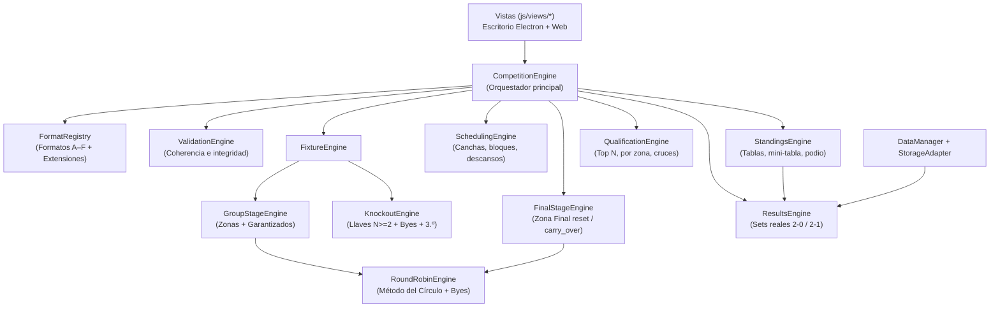

# Arquitectura del Sistema — N3com

## 1. Principios Arquitectónicos

1. **Base de código única (Escritorio + Web):** Electron (`electron/main.js`) y la versión web (`server.js`) sirven exactamente los mismos archivos HTML/CSS/JS y comparten el mismo motor de competición (`js/engine/`).
2. **Separación de responsabilidades:** La lógica deportiva pura (cálculo de sets, tablas, round-robin, llaves eliminatorias, validaciones) está desacoplada de la interfaz y preparada para reutilizarse tanto en navegador como en Node.js.
3. **Retrocompatibilidad estricta:** Todos los servicios históricos (`DataManager`, `SchedulerService`, `LogisticsService`, `PosicionesService`, `PlayoffsService`, `SpecialCrossService`, `fixturePdf.js`) conservan sus contratos y leen torneos antiguos sin pérdida ni alteración de IDs.
4. **Sección Planificación estable:** `js/views/planningView.js` y `js/domain/tournamentStages.js` actúan como unidad cerrada y estable.

---

## 2. Mapa de Directorios

```text
N3com/
├── index.html                  # Aplicación principal de torneos
├── admin.html                  # Panel administrativo de licencias
├── server.js                   # Servidor HTTP local endurecido (allowlist + API + auth)
├── electron/
│   └── main.js                 # Contenedor de escritorio Electron (sandbox + single instance)
├── services/                   # Servicios backend Node.js (nunca expuestos al navegador)
│   ├── adminAuthService.js     # Autenticación scrypt + sesiones HttpOnly + CSRF + rate limit
│   ├── licenseService.js       # Persistencia atómica de private/licenses.json
│   └── signedLicenseService.js # Firma y verificación asimétrica Ed25519 (v2)
├── js/
│   ├── main.js                 # Router SPA principal (#/torneos, #/torneo/:id/:seccion)
│   ├── adminAccess.js          # Flujo de acceso / configuración inicial del panel admin
│   ├── core/                   # Estado, navegación, tema, escapeHtml, auth cliente, licencias v1
│   ├── domain/                 # Etapas canónicas de planificación (tournamentStages.js)
│   ├── data/                   # DataManager, StorageAdapter, LicenciaRepo
│   ├── engine/                 # Motor central modular de competición (12 módulos + barrel)
│   │   ├── competitionEngine.js
│   │   ├── formatRegistry.js
│   │   ├── roundRobinEngine.js
│   │   ├── groupStageEngine.js
│   │   ├── knockoutEngine.js
│   │   ├── finalStageEngine.js
│   │   ├── fixtureEngine.js
│   │   ├── schedulingEngine.js
│   │   ├── standingsEngine.js
│   │   ├── resultsEngine.js
│   │   ├── qualificationEngine.js
│   │   ├── validationEngine.js
│   │   └── index.js
│   ├── services/               # Servicios de logística, scheduler, playoffs, cruces y PDF/XLSX/CSV
│   └── views/                  # Vistas de UI + configurador de formatos A–F
├── css/                        # Estilos compartidos (modo oscuro/claro, responsive e impresión)
├── docs/                       # Documentación técnica y funcional
└── tests/                      # Suite automatizada Node test runner (`npm test`)
```

---

## 3. Grafo del Motor de Competición (`js/engine/`)



---

## 4. Persistencia y Camino hacia Multi-Organización Online

- **Hoy (Local / Offline-first):**
  - Datos de torneos: `localStorage` (`newcom_data`) protegido con recuperación resiliente y respaldos JSON exportables/importables (`exportBackupSnapshot` / `importBackupSnapshot`).
  - Licencias y credenciales administrativas: archivos privados en disco (`private/licenses.json`, `private/admin.json`, `private/license-signing.json`) con escrituras atómicas y permisos `0600`.
- **Evolución futura sin reescribir el motor:**
  - `js/data/storageAdapter.js` define el puerto de almacenamiento (`readRaw`/`writeRaw`).
  - Para soportar sincronización online real entre múltiples dispositivos y organizaciones se deberá incorporar un backend dedicado (API REST + PostgreSQL + autenticación por organización/roles JWT/cookies + RBAC), conectándolo a través de un nuevo adaptador sin modificar `js/engine/`.

---

## 5. Modelo de Seguridad Defensiva

1. **Aislamiento de Electron:** `contextIsolation: true`, `nodeIntegration: false`, `sandbox: true`, `webSecurity: true`, `allowRunningInsecureContent: false`, denegación total de permisos del navegador/SO, bloqueo de popups y restricción de navegación/redirección al origen local.
2. **Servidor HTTP endurecido (`server.js`):**
   - Allowlist estricta de archivos estáticos (`/index.html`, `/admin.html`, `/css/*`, `/js/*`, `/assets/*`).
   - Cabeceras `CSP` (`script-src 'self'` sin `unsafe-inline`), `X-Content-Type-Options: nosniff`, `X-Frame-Options: DENY`, `Referrer-Policy: no-referrer`, `Cross-Origin-Resource-Policy: same-origin`.
   - Validación de `Host` (mitigación DNS rebinding) y `Origin` (mitigación CSRF cross-origin).
3. **Autenticación y Licencias:**
   - Contraseñas administrativas hasheadas con `scrypt` + sal aleatoria, verificadas en tiempo constante (`timingSafeEqual`) con rate limiting progresivo.
   - Sesiones administrativas mediante cookie `HttpOnly; SameSite=Strict` + header obligatorio `X-CSRF-Token`.
   - Firma asimétrica **Ed25519 (v2)** para nuevas licencias (`NWC2-...`) cuya clave privada nunca sale del directorio privado del servidor; verificación retrocompatible de licencias portátiles v1 (`NWC-P...`).
4. **Prevención de XSS:** escape contextual centralizado (`js/core/escapeHtml.js`) en todas las vistas antes de interpolar datos de usuario en el DOM.
